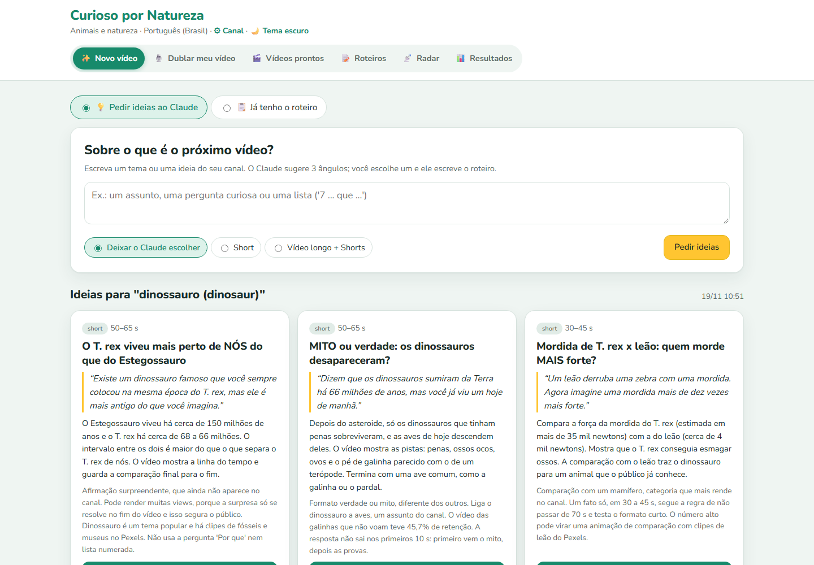
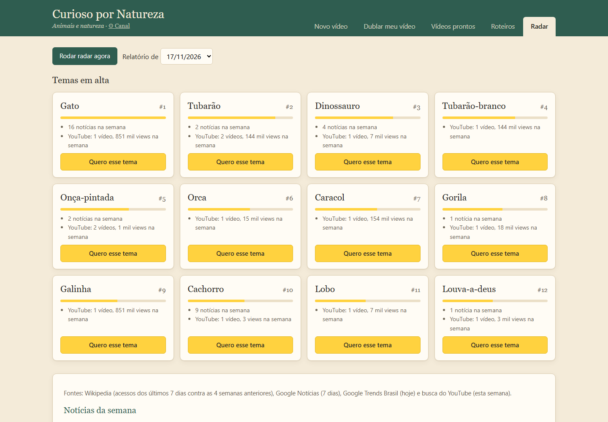
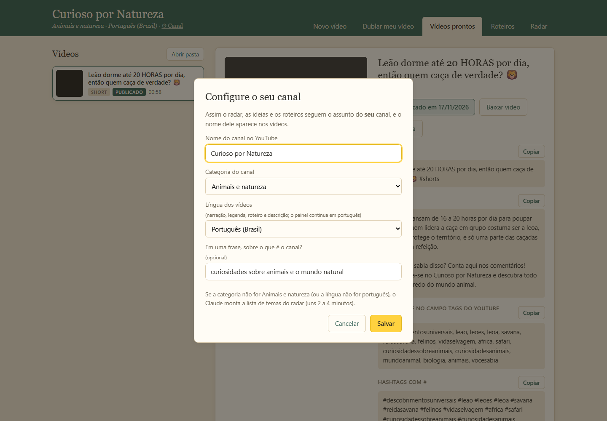

# video-creator

🇺🇸 **English** · 🇧🇷 [Português](README.pt-BR.md)

A **free** YouTube video generator that runs on your own computer with
[Claude Code](https://claude.com/claude-code). Tell it your **channel name**, your **niche** (animals,
history, science, cooking...) and the **video language** (English, Spanish or Brazilian Portuguese).
It finds trending topics, writes the script, records a neural voice-over, pulls footage from Pexels,
edits the video with captions, and hands you everything ready to publish: video, title, description,
tags, thumbnail and the best time to post.

- **Shorts** (vertical, 30 s to 2 min) and **long videos** (horizontal) that are automatically cut into Shorts
- **Trending topic radar**: Wikipedia, Google News, Google Trends and YouTube
- **Ideas and scripts from the panel**: Claude suggests angles, fact-checks and writes the script
- **Dub your own videos**: paste a script and your video gets voice-over and captions
- **Relaxing sound videos** (rain, wind, birds) from 10 minutes to hours, with synthesized audio
- Videos in **English, Spanish or Portuguese**: voice, captions, script, description and the radar's country all follow the language
- Everything in a browser panel; you just upload to YouTube

> The panel's interface is in Portuguese. The videos it makes can be in English or Spanish.


## Screenshots

| New video: ideas from Claude | Trending topic radar |
|---|---|
|  |  |

| Scripts: render with one click | Dub your own video |
|---|---|
|  |  |

| First run: set up your channel |
|---|
|  |

## Installation (Windows)

### Fastest way: let Claude Code install it

If you have Claude Code, open it in the folder where you want the project and paste:

```text
Install https://github.com/IngridSlytherin/video-creator for me following the "Installation (Windows)" section of its README: install whatever is missing among Node.js 18+, Python 3.11+, ffmpeg and Git with winget; clone the repo; run npm install and python -m pip install -r requirements.txt (check that python -I -c "import edge_tts, requests, numpy, scipy" works, otherwise use python -s -m pip install -r requirements.txt); install the Remotion skills with npx skills add remotion-dev/skills; create .env from .env.exemplo and explain how to get a free Pexels API key (don't ask me for the key in the chat, I'll paste it into .env myself); then tell me how to open the panel and run a final test.
```

Approve each command it asks to run. That's it.

### Manual installation

#### 1. Required software (all free)

| Software | What for | How to install |
|---|---|---|
| [Node.js](https://nodejs.org) 18+ | Remotion (video editing) | `winget install OpenJS.NodeJS.LTS` |
| [Python](https://www.python.org) 3.11+ | Voice-over, radar, panel | `winget install Python.Python.3.13` |
| [ffmpeg](https://ffmpeg.org) | Audio and video | `winget install Gyan.FFmpeg` |
| [Git](https://git-scm.com) | Download the project | `winget install Git.Git` |
| [Claude Code](https://claude.com/claude-code) | Ideas, scripts and the `/radar` command | Optional, but recommended (requires a Claude plan) |

Close and reopen the terminal after installing so the new commands are found.

#### 2. Download the project and install dependencies

```bash
git clone https://github.com/IngridSlytherin/video-creator.git
```

```bash
cd video-creator
```

```bash
npm install
```

```bash
python -m pip install -r requirements.txt
```

#### 3. Free Pexels API key (footage)

1. Create an account at [pexels.com/api](https://www.pexels.com/api/) and copy your key.
2. Copy `.env.exemplo` to `.env` and paste the key after `PEXELS_API_KEY=`.

```bash
copy .env.exemplo .env
```

#### 4. Background music (optional)

Put **instrumental** `.mp3` files in `public/musica/`. YouTube Studio > Audio Library is a good
source of music you're allowed to use. Without music, videos only have the voice-over.

#### 5. Remotion skills for Claude Code (optional)

They teach Claude how to change the look of the videos (effects, captions, maps):

```bash
npx skills add remotion-dev/skills
```

## How to use

### Open the panel

Double-click **`Abrir painel.bat`**. The panel opens in your browser at `http://localhost:8765`.
Keep the black window open while you use it; closing it shuts the panel down.

**On the first run**, the panel asks for your **channel name**, **niche** and **video language**.
That's what makes the radar, ideas and scripts follow *your* channel's topic, the voice-over speak
the right language and your channel name appear in the videos. If your niche isn't "Animais e
natureza" (or your language isn't Portuguese), Claude Code builds the radar's topic list for you
(2–4 minutes). Click **⚙ Canal** to change it later.

### From idea to published video

1. **Radar**: click *Rodar radar agora* to see trending topics. On one you like, click **Quero esse tema**.
2. **Novo vídeo** (New video): Claude suggests 3 angles (title, hook and why it should work).
   Click **Escrever este roteiro**: it fact-checks online and saves the script.
3. Read the narration preview and click **Gerar vídeo agora**. A Short takes about 3 minutes;
   a long video plus its Shorts, about 15.
4. **Vídeos prontos** (Finished videos): watch it, copy title, description and tags with one click,
   download the thumbnail and check the best time to post. Upload in YouTube Studio and tick **Já publiquei**.

You can also type a topic straight into **Novo vídeo** without using the radar.

### Dub your own video

In **Dublar meu vídeo**: upload your video, paste the script (each line is one sentence of the
voice-over) and click **Dublar vídeo**. Vertical videos become Shorts; horizontal ones become long
videos. You choose whether to keep the original audio (low or normal) and whether to add captions and music.

### From Claude Code

Open the project folder in Claude Code and type **`/radar`**: it shows trending topics for your
channel; pick one and it writes the script and renders the video. To change how videos look, just
ask ("captions with a dark background", "a map showing where the animal lives"...).

### Relaxing sound videos

```bash
python -I pipeline/relaxante.py relax/chuva-vento-passaros-12min.json
```

Renders 12 minutes of light rain → rain → wind and birds, with nature footage and a thumbnail.
The audio is synthesized, so there are no third-party copyrights. Each video is a file in `relax/`;
copy one and change the parts and minutes.

Full guide (in Portuguese), covering hand-written scripts, long videos, hashtags and settings:
**[COMO-USAR.md](COMO-USAR.md)**.

## Updates

When a new version is out, the panel shows a **"Nova versão do app disponível"** banner with what
changed. Click **Atualizar agora**: it downloads the new version, installs only what changed and
restarts the panel by itself. Your channel settings, Pexels key, scripts and videos are kept.
What changed in each version: **[CHANGELOG.md](CHANGELOG.md)**. You can also update from the
project folder with `git pull`.

## Tips

- **Retention**: copy `dados/aprendizados.exemplo.md` to `dados/aprendizados.md` and write down what
  works on your channel (YouTube Studio > Analytics). Claude reads it before suggesting ideas and writing scripts.
- **Best time to post**: put your audience's peak hours in `"horarios"` in `dados/canal.json`.
- **When publishing**: the voice-over is synthetic, so set "Altered or synthetic content" to *Yes* in YouTube Studio.
- **Topics**: footage comes from Pexels, so topics that exist in stock footage work best (nature,
  science, places, food, objects). Games, movies and celebrities don't.

## Troubleshooting

| Problem | Fix |
|---|---|
| `ModuleNotFoundError` when rendering | Run `python -s -m pip install -r requirements.txt` (installs where `python -I` looks) |
| `ffmpeg` not found | Install ffmpeg and reopen the terminal |
| Panel says it can't find Claude Code ("não achei o Claude Code") | Install Claude Code, or use `/radar` inside Claude Code |
| Changed something and the panel doesn't show it | Close the black window and open `Abrir painel.bat` again |

## Credits and licenses

- Video editing with [Remotion](https://www.remotion.dev): free for individuals and companies of up
  to 3 people. Larger companies need a [license](https://www.remotion.dev/license).
- Footage from [Pexels](https://www.pexels.com) (free to use).
- Voice-over with [edge-tts](https://github.com/rany2/edge-tts) (Microsoft neural voices).
