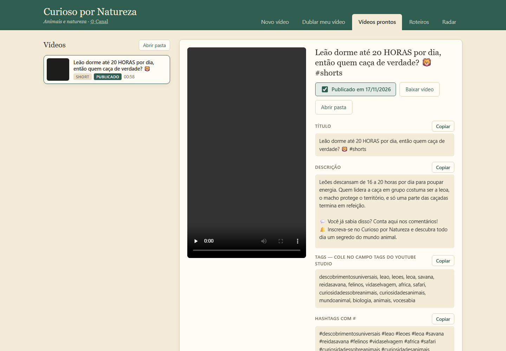
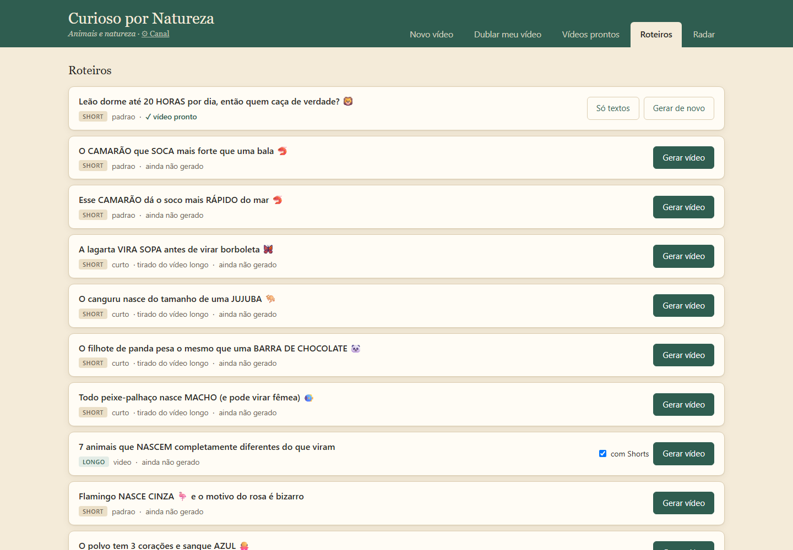
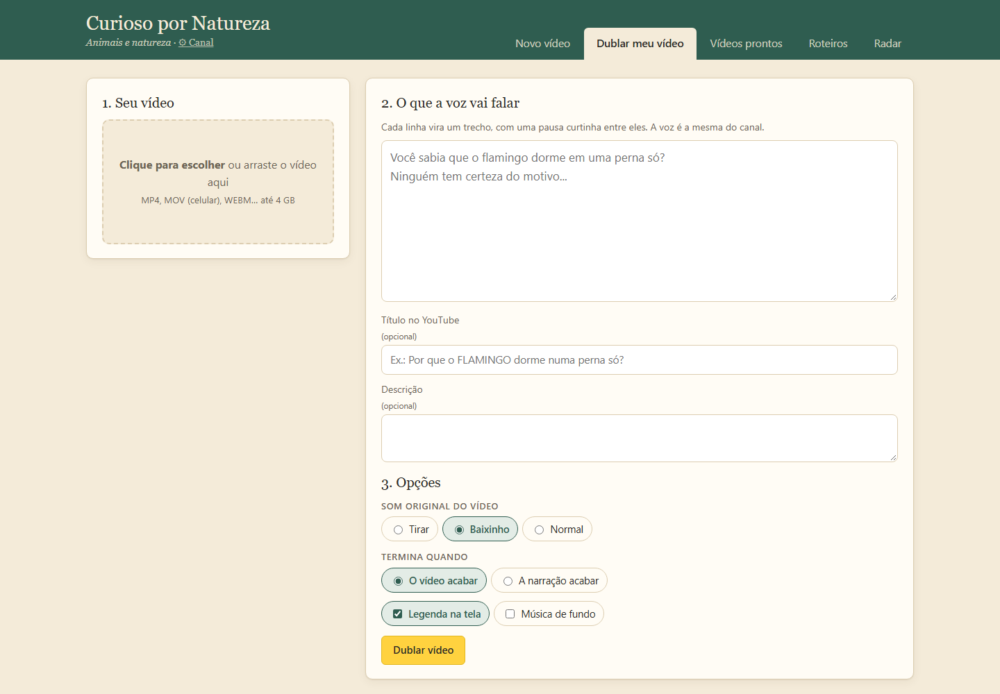

# video-creator

Gerador **gratuito** de vídeos para YouTube, feito para rodar no seu computador com o
[Claude Code](https://claude.com/claude-code). Você informa o **nome do seu canal** e a **categoria**
(animais, história, ciência, culinária...). O sistema acha temas em alta, escreve o roteiro, grava a
narração com voz neural, busca clipes no Pexels, monta o vídeo com legendas e entrega tudo pronto
para publicar: vídeo, título, descrição, tags, thumbnail e o melhor horário de postar.

- **Shorts** verticais (30 s a 2 min) e **vídeos longos** horizontais, que viram vários Shorts automaticamente
- **Radar de temas em alta**: Wikipedia, Google Notícias, Google Trends e YouTube
- **Ideias e roteiros pelo painel**: o Claude sugere ângulos, confere os fatos e escreve o roteiro
- **Dublar o seu próprio vídeo**: cole um texto e ele ganha narração e legenda
- **Vídeos de sons relaxantes** (chuva, vento, pássaros) de 10 minutos a horas, com som sintetizado
- Tudo numa interface no navegador; você só publica no YouTube



## Prints

| Novo vídeo: ideias do Claude | Radar de temas em alta |
|---|---|
|  |  |

| Roteiros: gerar com um clique | Dublar o seu vídeo |
|---|---|
|  |  |

| Primeira vez: configure o seu canal |
|---|
|  |

## Instalação (Windows)

### 1. Programas necessários (todos gratuitos)

| Programa | Para quê | Como instalar |
|---|---|---|
| [Node.js](https://nodejs.org) 18 ou mais novo | Remotion (montagem do vídeo) | `winget install OpenJS.NodeJS.LTS` |
| [Python](https://www.python.org) 3.11 ou mais novo | Narração, radar, painel | `winget install Python.Python.3.13` |
| [ffmpeg](https://ffmpeg.org) | Áudio e vídeo | `winget install Gyan.FFmpeg` |
| [Git](https://git-scm.com) | Baixar o projeto | `winget install Git.Git` |
| [Claude Code](https://claude.com/claude-code) | Ideias, roteiros e o comando `/radar` | Opcional, mas recomendado |

Depois de instalar, feche e abra o terminal de novo para os comandos funcionarem.

### 2. Baixar o projeto e instalar as dependências

```bash
git clone https://github.com/IngridSlytherin/video-creator.git
```

```bash
cd video-creator
```

```bash
npm install
```

```bash
python -m pip install -r requirements.txt
```

### 3. Chave gratuita do Pexels (imagens)

1. Crie uma conta em [pexels.com/api](https://www.pexels.com/api/) e copie a sua chave.
2. Copie o arquivo `.env.exemplo` com o nome `.env` e cole a chave em `PEXELS_API_KEY=`.

```bash
copy .env.exemplo .env
```

### 4. Música de fundo (opcional)

Coloque arquivos `.mp3` de música **instrumental** em `public/musica/`. Uma boa fonte é o
YouTube Studio > Biblioteca de áudio, que tem músicas que você pode usar nos seus vídeos.
Sem música, o vídeo sai só com a narração.

### 5. Skills do Remotion para o Claude Code (opcional)

Ensinam o Claude a mexer no visual dos vídeos (efeitos, legendas, mapas):

```bash
npx skills add remotion-dev/skills
```

## Como usar

### Abrir o painel

Dê dois cliques em **`Abrir painel.bat`**. O painel abre no navegador em `http://localhost:8765`.
A janela preta precisa ficar aberta enquanto você usa; fechar a janela desliga o painel.

**Na primeira vez**, o painel pede o **nome do seu canal** e a **categoria**. É isso que faz o radar,
as ideias e os roteiros seguirem o assunto do *seu* canal, e o nome aparecer nos vídeos. Para
categorias que não são "Animais e natureza", o Claude Code monta a lista de temas do radar (2 a 4 minutos).
Para mudar depois, clique em **⚙ Canal**.

### O caminho de um vídeo

1. **Radar**: clique em *Rodar radar agora* para ver os temas em alta. Em um tema que agradar,
   clique em **Quero esse tema**.
2. **Novo vídeo**: o Claude sugere 3 ângulos (título, gancho e por que deve funcionar).
   Clique em **Escrever este roteiro**. Ele confere os fatos na internet e salva o roteiro.
3. Leia a narração na prévia e clique em **Gerar vídeo agora**. Um Short leva uns 3 minutos;
   um vídeo longo com Shorts, uns 15.
4. **Vídeos prontos**: assista, copie título, descrição e tags com um clique, baixe a thumbnail
   e veja o melhor horário para postar. Publique no YouTube Studio e marque **Já publiquei**.

Também dá para escrever o tema direto na aba **Novo vídeo**, sem passar pelo radar.

### Dublar o seu próprio vídeo

Na aba **Dublar meu vídeo**: envie o vídeo, cole o texto (cada linha é um trecho da fala) e clique em
**Dublar vídeo**. Vertical vira Short; horizontal vira vídeo longo. Você escolhe se mantém o som
original (baixinho ou normal) e se quer legenda e música.

### Pelo Claude Code

Abra a pasta do projeto no Claude Code e digite **`/radar`**: ele mostra os temas em alta do seu canal,
você escolhe um e ele escreve o roteiro e gera o vídeo. Para mudar o visual dos vídeos, é só pedir
("legenda com fundo escuro", "mapa mostrando onde o animal vive"...).

### Vídeos de sons relaxantes

```bash
python -I pipeline/relaxante.py relax/chuva-vento-passaros-12min.json
```

Gera 12 minutos de chuva fraca → chuva → vento e pássaros, com imagens de natureza e thumbnail.
O som é sintetizado por computador, sem direitos autorais de terceiros. Cada vídeo é um arquivo
em `relax/`; copie e mude as partes e os minutos.

Guia completo, com roteiro à mão, vídeo longo, hashtags e configurações: **[COMO-USAR.md](COMO-USAR.md)**.

## Dicas

- **Retenção**: copie `dados/aprendizados.exemplo.md` para `dados/aprendizados.md` e anote o que
  funciona no seu canal (YouTube Studio > Estatísticas). O Claude lê esse arquivo antes de sugerir
  ideias e escrever roteiros.
- **Ao publicar**: a narração é voz sintética, então marque "Conteúdo alterado ou sintético" como
  *Sim* no YouTube Studio.
- **Temas**: as imagens vêm do Pexels, então funcionam melhor temas que existem em banco de imagens
  (natureza, ciência, lugares, comida, objetos). Jogos, filmes e pessoas famosas não funcionam.

## Problemas comuns

| Problema | Solução |
|---|---|
| `ModuleNotFoundError` ao gerar | Rode `python -s -m pip install -r requirements.txt` (instala onde o `python -I` enxerga) |
| `ffmpeg` não encontrado | Instale o ffmpeg e abra o terminal de novo |
| Painel diz "não achei o Claude Code" | Instale o Claude Code; ou use o `/radar` direto no Claude Code |
| Mudou algo e o painel não mostra | Feche a janela preta e abra o `Abrir painel.bat` de novo |

## Créditos e licenças

- Montagem de vídeo com [Remotion](https://www.remotion.dev): gratuito para pessoas físicas e empresas
  de até 3 pessoas. Empresas maiores precisam de [licença](https://www.remotion.dev/license).
- Imagens do [Pexels](https://www.pexels.com) (uso gratuito).
- Narração com [edge-tts](https://github.com/rany2/edge-tts) (vozes neurais da Microsoft).
